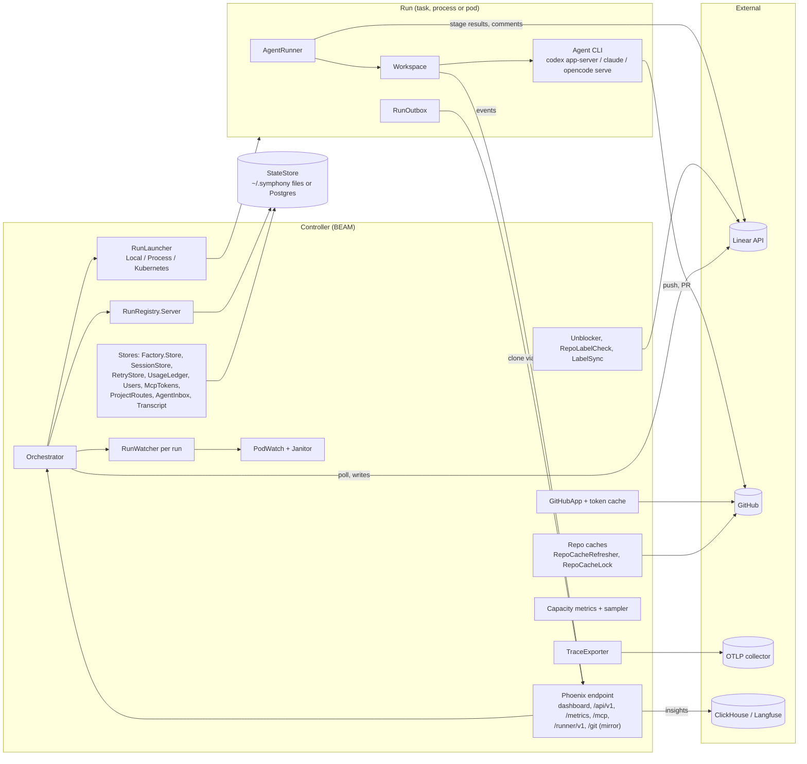
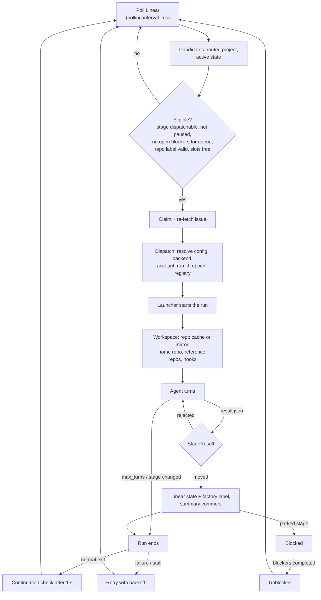
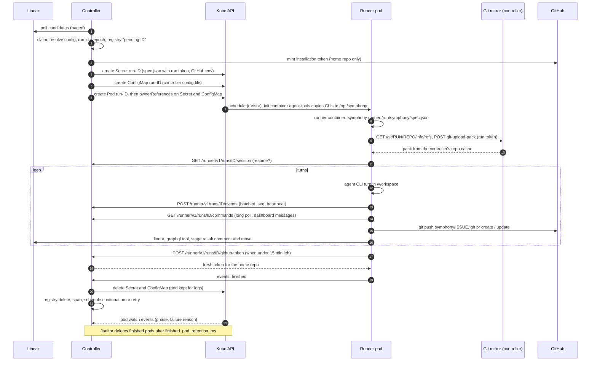

# Symphony architecture

This page explains how the Elixir implementation of Symphony (`elixir/`) is put together and how
an issue moves through it. It describes the code as it is. Module names are under
`elixir/lib/symphony_elixir/` (and `elixir/lib/symphony_elixir_web/` for the web layer) unless a
path says otherwise. For the language-neutral contract, see [`SPEC.md`](../SPEC.md).

## Contents

- [What it is](#what-it-is)
- [Concepts](#concepts)
- [Components](#components)
- [Lifecycle of an issue](#lifecycle-of-an-issue)
- [Durability](#durability)
- [Launchers compared](#launchers-compared)
- [Security model](#security-model)
- [Observability](#observability)
- [Scaling](#scaling)
- [Configuration map](#configuration-map)
- [Further reading](#further-reading)

## What it is

Symphony is a long-running service, the **controller**, that polls Linear for issues, works out
which stage of a team's **factory flow** each one is in, and starts an unattended coding agent
(Codex, Claude Code or OpenCode) for every issue in an agent stage. Each run gets its own git
clone of the issue's repository. The agent works in turns until it writes a stage result, which
moves the issue to the next stage of the flow (for example from implement to review), or until
the issue leaves an active state. Runs can be in-process tasks, detached OS processes, or
Kubernetes pods. Pods and processes outlive a controller restart and report back over an HTTP
runner API. A Phoenix LiveView dashboard and an MCP endpoint show and steer the factory.

## Concepts

| Concept | What it is in the code |
|---|---|
| **Issue** | A `Linear.Issue` from the poll query: state, labels, project slug, priority, `blocked_by`. Its **team** is the identifier prefix (`PAY-12` is team `PAY`). |
| **Project (route)** | Maps a Linear project slug to a GitHub repo, plus optional extra `repos`, `workflow`, `prompt`, `hooks`, `backend`, `environment`, `workspace_root`. Routes come from `projects:` in `symphony.yml` and from routes added at runtime over MCP (`ProjectRoutes`, stored in `project_routes.json`); the file wins on a clash. An issue is routed by its project slug. |
| **Home repo** | The repo the agent works in and pushes to: the one the issue's `repo/<name>` label names, else the route's primary repo (`Config.check_issue_repo/2`). |
| **Reference repos** | The project's other repos, checked out read-only and detached under `<workspace>/.symphony/repos/<name>` and refreshed every run. |
| **Flow** | A team's (or project's) factory: `stages` and `transitions` (`Factory.Definition`). Stage kinds are `queue`, `agent`, `human`, `parked` and `done`; only unpaused `queue` and `agent` stages dispatch. Flows live in `Factory.Store` (`factories/<TEAM>.json`, `factories/project--<slug>.json`, `DEFAULT.json`), and an issue uses its project's flow, else its team's, else `DEFAULT`, else the built-in template (todo, implement, review, merge, done, plus rework and blocked loops). |
| **Stage** | Identified by a Linear state plus an optional `factory/<label>` label (`IssueStage`). A stage can set instructions, skill, harness, effort, environment, `max_agents`, `paused`, approval and `checks`. Transitions are `{from, to, by: agent \| human}`. |
| **Run** | One dispatch of `AgentRunner.run/3` for one issue and stage, with a random `run_id` and an `epoch` (`RunRegistry`). |
| **Attempt** | The retry counter for an issue (`retry_attempts`, persisted in `retries.json`). A continuation after a normal exit is attempt 1; each failure adds one. There is no maximum. |
| **Turn** | One prompt to the agent within a run's backend session, up to `agent.max_turns` (default 20). |
| **Workspace** | The per-issue directory `<workspace_root>/<safe identifier>`: a standalone clone of the home repo on branch `symphony/<identifier>` (`Workspace`). |
| **Launcher** | How a run is started: `local` (a task in the controller), `process` (a detached `symphony runner` process) or `kubernetes` (a runner pod). Chosen by `agent.launcher` (`RunLauncher`). |
| **Runner** | The `symphony runner <spec.json>` program that executes one run outside the controller and talks to it through `RunHost.Remote` (`Runner`). |
| **Run host** | The seam between a run and the controller (`RunHost`): `RunHost.Local` makes in-process calls, `RunHost.Remote` uses the `/runner/v1` HTTP API. |

## Components

### Supervision tree

`SymphonyElixir.Application` starts one `:one_for_one` supervisor. Its children depend on the
app mode: the **controller** (default) or a **runner** (`symphony runner ...` sets
`:app_mode` to `:runner`). Order matters: stores start before the orchestrator, and the run
registry starts before the orchestrator and the runner endpoints.

| Controller child | Role |
|---|---|
| `Phoenix.PubSub`, `Task.Supervisor` | Dashboard broadcasts; tasks for polls, Linear calls, local runs. |
| `StateStore.Supervisor` | Starts `Repo` and runs migrations when `SYMPHONY_DATABASE_URL` is set. |
| `SymphonyConfigStore` / `WorkflowStore` | Loads `symphony.yml` (or legacy `WORKFLOW.md`) and reloads it on change (1 s mtime poll). |
| `TraceExporter` | Bounded OTLP/HTTP JSON exporter for Symphony's own spans. |
| `UsageLedger`, `SessionStore`, `Transcript`, `SessionHistory`, `AgentInbox` (+ Registry), `Pricing` | Usage and cost, session resume, per-issue transcripts, ended sessions, messages to agents, model prices. |
| `Observability.Cache` | Caches ClickHouse and Langfuse reads for the insights page. |
| `Factory.Store` | Flows; rescans its directory (or table) every 2 s. |
| `Users`, `Auth`, `McpTokens`, `ProjectRoutes` | Accounts, identity and permissions, MCP tokens, runtime project routes. |
| `GitHubApp.Cache` | Installation tokens, single-flight minting per repo and permission set. |
| `LabelSync` | Creates missing `factory/*`, approval and `repo/*` labels in Linear once, in the background. |
| `RepoCacheLock`, `RepoCacheRefresher` | Per-cache mutex; keeps project repo caches fresh. |
| `Unblocker`, `RepoLabelCheck` | Moves blocked issues back once blockers are done; comments on bad `repo/*` labels. |
| `GitMirror.Limiter` | Caps concurrent `git upload-pack` for the mirror. |
| `RunnerCommands` | In-memory command queues the runners long-poll. |
| `Capacity.Metrics`, `Capacity.RunUsage` | Capacity counters and histograms; CPU and memory that runners report. |
| `RunRegistry.Server` | Single writer and ETS cache of the run registry. |
| `RunLauncher.Process.ProcessTable` | One shared `ps` snapshot for process-run liveness checks. |
| `RunWatcher.LastSeen`, `RunWatcher.Registry`, `RunWatcher.Supervisor` | Last event time per run; one watcher per process or pod run. |
| `RunLauncher.Kubernetes.Janitor`, `RunLauncher.Kubernetes.PodWatch` | Kubernetes only: sweeps finished pods and orphaned Secrets; one cached watch over runner pods. |
| `Orchestrator` | Poll, dispatch, reconcile, retry. |
| `Capacity.Sampler` | Samples per-run CPU, memory and tokens. |
| `HttpServer` | The Phoenix endpoint. |
| `StatusDashboard` | Terminal dashboard and the dashboard update fan-out. |
| `ClaudeCode.RateLimitPoller` | Polls Claude account rate limits. |

A runner starts only what `AgentRunner` needs: PubSub, Task.Supervisor, StateStore.Supervisor,
the config store, `Factory.Store`, `RepoCacheLock`, `GitHubApp.Cache`, `RunOutbox`,
`TraceExporter` and the command poller registry. Session, inbox, transcript and usage work
happens in the controller through `RunHost.Remote`.

## Lifecycle of an issue

### 1. Poll and choose candidates

- `Orchestrator` polls every `polling.interval_ms` (default 30 s) in a task; refresh requests
  that arrive mid-poll fold into one more poll. A poll whose config changed is discarded and run
  again.
- `Tracker.fetch_candidate_issues/0` (`Linear.Client`) asks for issues in all routed projects
  whose state is in `tracker.active_states` (default Todo, In Progress) or is a state some saved
  flow dispatches from. Pages hold 100 issues (one retry of a failing page at 50); relations are
  fetched 50 at a time. Running issues that drop out of the candidate set are fetched by id in
  batches of 100.
- Each poll also feeds `UsageLedger`, `Unblocker` and `RepoLabelCheck`.

### 2. Eligibility, ordering and claim

- An issue is dispatched only if it routes to this controller, its state is active and not
  terminal, its stage is a dispatchable kind and not paused (`tracker.paused_stages`, the
  stage's `paused` flag, missing `tracker.require_label`, or the `tracker.approval_label`), a
  queued issue has no open blocker, it is not already claimed or running, and its config
  resolves (this includes the `repo/*` label check).
- Caps: `agent.max_concurrent_agents` (default 10) globally,
  `agent.max_concurrent_agents_by_state` per Linear state, a stage's `max_agents`, and
  `worker.max_concurrent_agents_per_host` for SSH workers. A queue-stage issue leaves the queue
  only while fewer issues than `max_concurrent_agents` are in agent stages, so issues between
  runs keep their slot.
- Order: deepest stage in the flow first, then Linear priority, then age, then identifier.
- Claim: the id goes into `claimed`, the issue is re-fetched in a task, and the claim is
  released if it no longer qualifies.

### 3. Dispatch

`do_dispatch_issue/4` resolves the issue config (`IssueConfig`) and the backend and effort
(`AgentRoute`: a `codex`/`claude`/`opencode` label, else the stage's harness, else
`agent.backend`; `thinking/<level>` labels, else the stage's effort, else
`agent.default_effort`). It picks a worker host and a managed account (`Accounts`), generates a
run id and the next epoch, records the run in `RunRegistry` with a `pending:<run_id>` reference,
starts it with the configured launcher, then records the launcher's real reference. Process and
Kubernetes runs get a `RunSpec` with a signed run token. No new run starts while a delayed
restart is pending.

### 4. Workspace

`Workspace.create_for_issue` builds `<workspace_root>/<safe identifier>`:

- **Repo cache.** Each repo has one clone under `<workspace_root>/.symphony-cache/<key>`, kept
  detached at `origin/<default branch>`. It fetches only when older than
  `workspace.repo_cache.max_age_ms` (default 60 s); `RepoCacheRefresher` refreshes every
  project repo every `refresh_interval_ms` (default 30 s). Syncs hold `RepoCacheLock` and use a
  read-only GitHub App token when one is configured.
- **Home repo.** The workspace is a standalone clone of the cache with hardlinked objects (not
  a worktree). It checks out `symphony/<identifier>` from the remote if it exists, so a previous
  run's PR branch is resumed, else branches from `origin/<default branch>`. If the home repo
  changes (the `repo/<name>` label moved), the workspace is recreated.
- **Reference repos** are checked out under `.symphony/repos/<name>`, which is added to the home
  repo's `.git/info/exclude`.
- **Without a local cache** (a runner pod), the runner builds the same layout from the
  controller's read-only git mirror (`GitMirror.clone_commands/3`), with `origin` set to the
  real GitHub URL so pushes go to GitHub.
- **Hooks** run with `hooks.timeout_ms` (default 60 s): `after_create` for a new workspace (a
  failure deletes it), `before_run` (a failure fails the run), `after_run` and `before_remove`
  (best effort). With `sandbox.kind: docker` they run inside the issue's container.

### 5. Agent turns and events

`AgentRunner.run/3` reports runtime info, runs `before_run`, moves a queue-stage issue to its
agent stage (`pick_up`), and starts the backend:

| Backend | Process and protocol | Linear tool |
|---|---|---|
| Codex | `codex app-server`, JSON-RPC 2.0 over stdio: `thread/start` or `thread/resume`, `turn/start`, `turn/steer` for dashboard messages. Default thread sandbox `workspace-write`, no network in the turn sandbox, approval requests rejected unless `approval_policy` is `never`. | `linear_graphql` dynamic tool |
| Claude Code | One long-lived `claude -p --input-format stream-json --output-format stream-json`, with `--session-id` or `--resume`. | Generated workspace-local MCP server |
| OpenCode | `opencode serve` on a random local port, HTTP plus SSE events. Permission requests are allowed only for listed kinds inside the workspace. Local only. | Generated custom tool |

The first turn's prompt comes from `PromptBuilder` (the built-in or `WORKFLOW.md` prompt, the
stage's section from `StagePrompt`, and `RepoPrompt` for multi-repo projects); a resumed session
gets a short "continue" prompt instead. Queued dashboard messages are prepended to the next turn
(or steered into a running Codex turn). Agent events (tokens, activity, rate limits, transcript
notes) go to the controller through the run host; a remote runner sends them through its
outbox.

### 6. Stage transitions, PR and finish

- The agent ends a stage by writing `.symphony/result.json` (`{"move": "<stage id>", "summary":
  ...}`). `StageResult.process/3` checks the move is an agent transition out of the current
  stage, runs the stage's `checks` (20 min timeout each; skipped for moves to parked or done),
  posts a `## <stage>` comment with an idempotent id, and sets the Linear state and `factory/*`
  label (adding the approval label when the stage requires approval). A move into a `done`
  stage also posts a final report (`IssueReport`). A rejected result gets another turn with the
  feedback.
- **Symphony does not open pull requests.** The agent pushes `symphony/<identifier>` and opens
  or updates the PR with `gh`, as the stage instructions tell it.
- After each turn the issue is re-fetched; the run ends when the stage changed, the issue left
  an active state, or `max_turns` was reached.
- **Normal exit:** a continuation check is scheduled after 1 s. **Failure:** a retry after
  `min(10 s * 2^(attempt-1), agent.max_retry_backoff_ms)` (default cap 5 min); an exhausted
  account waits until its reset. **Stall:** no event for the backend's `stall_timeout_ms`
  (default 5 min) stops the run and retries it.
- **Reconcile:** each poll stops runs whose issue became terminal (and removes the workspace),
  stopped routing here, lost the required label, was paused, or left the active states.
- **Human moves** come from the dashboard or MCP (`IssueMoves`), including approval reviews.

### 7. Blocked and unblocked

An agent marks an issue blocked by creating a "blocks" relation in Linear and moving to a
`parked` stage. `Unblocker` watches parked issues; once every blocker is `completed` (a
cancelled blocker keeps it blocked) it posts an `## Unblocked` comment with the blockers'
reports and moves the issue back to the stage it was blocked from (else `implement`, else the
first agent or queue target). `RepoLabelCheck` posts one `## Repo label problem` comment for
an unknown or conflicting `repo/*` label; such issues are never dispatched.

### A Kubernetes run end to end

## Durability

### Where state lives

`StateStore` is a document store with `read`, `write`, `create_once` and `list`. By default
documents are owner-only files under `~/.symphony` (`StateStore.File`, atomic writes). With
`SYMPHONY_DATABASE_URL` set, `StateStore.Supervisor` switches to Postgres
(`StateStore.Postgres`): one `state_documents` table (`key text` primary key, `body bytea`,
`updated_at`), keyed by the path relative to `~/.symphony`, with migrations run at start-up
under Ecto's migration lock.

| Key | Owner | Contents |
|---|---|---|
| `sessions.json` | `SessionStore` | Resumable agent sessions (issue, stage, backend, workspace, thread or session id). |
| `session_history.json` | `SessionHistory` | Ended sessions for the dashboard. |
| `retries.json` | `RetryStore` | Retry queue: attempt, due time, metadata. Re-armed on start. |
| `run_registry/<base64url issue id>.json` | `RunRegistry` | One document per issue (see below). Legacy `runs.json` is migrated once. |
| `inbox.json` | `AgentInbox` | Messages to agents. |
| `users.json` | `Users` | Accounts, password hashes, grants. |
| `usage.json` | `UsageLedger` | Token usage and cost. |
| `mcp_tokens.json` | `McpTokens` | MCP token hashes, scopes, expiry. |
| `project_routes.json` | `ProjectRoutes` | Projects added at runtime. |
| `factories/*.json` | `Factory.Store` | Flows per team, project and default. |
| `secret_key_base` | `HttpServer` | Session and run-token secret, created once. |

Not in the store: the config file (read from disk), managed account credentials
(`accounts.store_root`, read by the agent CLIs), and run directories
`~/.symphony/runs/<run_id>/` (`spec.json`, `github-token.json`, `outbox.jsonl`, `runner.log`),
which are always local files on the host that runs the runner.

### Run registry, epochs and run tokens

- A registry document is `{version, issue_id, epoch, run}`; `run` holds the run id, attempt,
  epoch, launcher module, launcher reference (`local:...`, `process:<pid>:<start time>`,
  `systemd:<unit>`, `k8s:<namespace>/<pod>`), start time, issue metadata, `last_seq` and
  `finished`.
- `RunRegistry.Server` is the single writer and keeps the registry decoded in ETS (indexed by
  issue and by run id), so a runner request costs one lookup. Records, deletes and `finished`
  are written synchronously; plain `last_seq` progress is coalesced to at most one write per
  second.
- The **epoch** is per issue and increases on every new dispatch; deleting a run keeps it.
  Adopting a run after a restart keeps its epoch.
- The **run token** is `base64url(HMAC-SHA256(secret_key_base, "<run_id>:<epoch>"))`
  (`RunToken`). `RunnerAuth` accepts it as a Bearer token or a Basic password (for git) and
  answers 404 for an unknown run, 409 `stale_epoch` for an older epoch, 409 `finished` after
  the run finished, and 401 otherwise. A runner that gets 409 stops: this fences a run that was
  replaced.

### Runner API and outbox

| Method and path under `/runner/v1/runs/:run_id` | Purpose |
|---|---|
| `POST /events` | Batched events; answers `{applied_through}`. |
| `GET`, `PUT`, `DELETE /session` | Session resume record. |
| `POST /inbox/take`, `GET /inbox/queued`, `GET /inbox/:id`, `POST /inbox/:id/delivered` | Dashboard messages to the agent. |
| `POST /codex_turn` | Registers the current Codex turn for steering. |
| `GET /commands?after=&wait_ms=` | Long poll (default 20 s, max 25 s) for commands. |
| `POST /github-token` | Fresh installation token for the home repo (10 per 10 min per run). |

Event types are `runtime_info`, `route_info`, `agent_update`, `transcript_note`,
`turn_started`, `heartbeat` (every 30 s), `metrics` and `finished`. `RunOutbox` appends every
event, with a monotonic `seq`, to `<run dir>/outbox.jsonl` and sends batches of up to 100 every
200 ms (immediately at 50 pending), retrying with backoff up to 5 s for as long as it takes.
The controller applies each `seq` once per run (`RunnerCommands.apply_events`) and the runner
drops what was acknowledged. Delivery is at least once, applied once. At the end the runner
waits up to `agent.runner_finish_flush_ms` for `finished` to be acknowledged. Commands queued in
`RunnerCommands` are in memory only.

### Run watchers

Process and Kubernetes runs have no BEAM process to monitor, so each gets a `RunWatcher`. It
checks `RunLauncher.status` every 5 s; a run that is `gone` gets 10 s for its outbox to deliver
`finished` before it counts as lost, and `unauthorized` for 5 min ends the run. Every runner
event updates `RunWatcher.LastSeen`, which the orchestrator's stall detection reads.

### Adoption after a controller restart

On start, `Orchestrator.init` restores retries, then `recover_runs/1` walks the registry:

1. A run marked `finished`, or dead with a `finished` event in its outbox file, is completed:
   deleted from the registry, cleaned up, and its after-exit step scheduled.
2. A run that is alive (or whose status is unknown) is **adopted**: a new `RunWatcher` is
   started with the same run id and reference, and the run goes back into `running` with the
   same epoch. Its token still verifies, because the epoch and `secret_key_base` are unchanged.
3. A dead run is released and retried with its next attempt after 1 s ("interrupted by a
   Symphony restart"), resuming its session if one was recorded.

Meanwhile runners keep working and buffer events. When the controller is back, their outboxes
replay and duplicates are dropped by `seq`.

### Deploys

- **SIGTERM** stops the controller without stopping runs: process runners and pods keep
  running and are adopted by the next controller. Local runs die with the BEAM and are retried.
- **Delayed restart** (`SIGHUP` or `POST /api/v1/restart`, cancelled with `DELETE`): no new runs
  start, and the controller exits once the last run finishes, for a supervisor to restart it.
  This is the safe deploy for the `local` launcher.
- **Kubernetes** additionally relies on ownerReferences (Secret and ConfigMap are deleted with
  the pod), the janitor, and a fresh pod list on start.

## Launchers compared

| | `local` | `process` | `kubernetes` |
|---|---|---|---|
| Where the agent runs | A task in the controller; agent CLIs are Ports of the BEAM. Optionally on SSH worker hosts or in a docker sandbox. | A detached `symphony runner` process on the controller host (own process group via `setsid`, or a `systemd-run` unit). | A runner pod per run in `agent.kubernetes.namespace` (default `symphony-runs`). |
| How it is started | `Task.Supervisor.start_child` | `agent.runner_command` template with the spec path | Secret + ConfigMap + Pod, then ownerReferences |
| Talks to the controller | `RunHost.Local` (in process) | `RunHost.Remote` over HTTP | `RunHost.Remote` over HTTP to `controller_url` |
| Workspace source | Local repo cache | Local repo cache | Controller's git mirror |
| Liveness | Process monitor | `ps` snapshot (`ProcessTable`) or `systemctl --user is-active` | `PodWatch` cache, GET on miss |
| Isolation | Controller user; optional docker sandbox | Same host and user, separate process group | Own pod: gVisor, non-root, no capabilities, no service account token |
| GitHub token | Host `gh` login or App token in env | Owner-only `github-token.json`, then refresh endpoint | Run Secret, then refresh endpoint |
| Survives a controller restart | No (retried with the next attempt) | Yes (adopted) | Yes (adopted) |
| Stop | Terminate the task | TERM to the group, KILL after 10 s | Delete Secret and ConfigMap; delete pod unless finished |
| Cleanup | Workspace removal | Spec deleted, logs and outbox kept | Janitor deletes finished pods after `finished_pod_retention_ms` (1 h) and orphaned `run-*` Secrets and ConfigMaps after 10 min |

**Runner pod shape** (`RunLauncher.Kubernetes.PodSpec`): `runtimeClassName: gvisor`, service
account `symphony-runner` with `automountServiceAccountToken: false`, the agents-sandbox node
pool selector and toleration, `restartPolicy: Never`, `activeDeadlineSeconds` (default 6 h),
pod and container `runAsNonRoot` with a numeric uid, `allowPrivilegeEscalation: false`, drop
`ALL`, `RuntimeDefault` seccomp, and a Kueue queue label. An `agent-tools` init container copies
the agent CLIs into an `emptyDir` at `/opt/symphony`; the `runner` container mounts the run
Secret's `spec.json` at `/run/symphony`, the ConfigMap at `/etc/symphony`, and a sized
`emptyDir` as the workspace. The controller talks to the API server with its projected service
account token, re-read on every request.

## Security model

### Isolation

- **Kubernetes:** gVisor pods with the hardened shape above. The admission policy the pods are
  rendered for admits only that shape: gVisor, the token-less `symphony-runner` service
  account, the agents-sandbox pool, non-root containers that drop `ALL`, and only the run's own
  `run-<run-id>` Secret and ConfigMap mounted.
- **Local and SSH:** `sandbox.kind: docker` runs each issue's hooks and agent in its own
  long-lived container (`sandbox.command` picks the engine, so Podman works too). Env vars are
  passed by name (`docker exec --env NAME`), so values stay out of process lists. Environment
  services run on a per-issue `--internal` network that has no route out, so they never widen
  the agent's network.
- **Environments** (`Environment`): the platform catalog in `symphony.yml` sets allowed image
  prefixes, resource maxima and service limits. A repo's `.symphony/environment.yaml` can only
  narrow them, and an invalid file fails closed: the run does not start.
- **Agent policies:** Codex runs with a workspace-write sandbox and no network in the turn
  sandbox by default, and rejects approval requests; OpenCode permission requests outside the
  workspace are rejected. Claude Code runs with `--permission-mode` from config (default
  `bypassPermissions`), so its isolation comes from the sandbox or pod.

### Secrets

- **Run Secret** `run-<id>`: `spec.json` (which includes the run token) and, with a GitHub App,
  `GH_TOKEN`, `GIT_TERMINAL_PROMPT`, `GIT_CONFIG_*` (an `http.extraHeader`) and
  `SYMPHONY_GITHUB_TOKEN_EXPIRES_AT`, each read by `secretKeyRef`. Other secrets reach the pod
  only through `agent.kubernetes.secret_env` references to existing Secrets.
- **GitHub App tokens** (`GitHubApp`): minted per repository with an allowlisted permission set
  (`contents`, `pull_requests`, `metadata`, `issues`, `checks`, `statuses`). Cache syncs get a
  read-only token. A run's token is scoped to its home repo; reference repos come through the
  read-only mirror. The runner refreshes the token through `/github-token` when under 15 min
  remain and serves it to git through a credential helper and to `gh` through `GH_CONFIG_DIR`,
  in owner-only files outside the workspace. Tokens are never put in a URL, `.git/config` or
  process arguments.
- **The App private key never leaves the controller.** A runner config file with a literal PEM
  is refused, `secret_env` may not pass `GITHUB_APP_PRIVATE_KEY`, and process runners start
  without it in their environment.
- **Git mirror** (`/git/:run_id/:repo`): read-only smart HTTP (`git-receive-pack` is refused),
  authenticated by the run token, limited to the repos of the run's own project, with the repo
  key matched against configured cache keys and never used as a path. Request bodies are capped
  at 8 MiB; at most `git_mirror.max_concurrent` (default 8) upload-packs run at once.

### Dashboard, API and MCP

- **Auth mode** (`Auth`): `server.auth` is `local` (no sign-in, admin, localhost requests only)
  or `accounts`; the default is `local` when the server binds to loopback.
- **Accounts:** username or email with a password (PBKDF2-SHA256, 600k iterations, lockout after
  five failures). The first account uses a setup code printed in the log. Later sign-ups must
  match an active Linear member's email and wait for admin approval. Roles and teams come from
  Linear (admin flag, team membership, guests read-only), plus Symphony grants. `Visibility`
  limits non-admins to their teams' and projects' issues and hides host fields.
- **Sessions:** an encrypted, signed cookie with a session version that a password change bumps;
  CSRF on browser routes; per-IP rate limits on login, signup and reset.
- **API** (`/api/v1/*`, `/metrics`): a session or `Authorization: Bearer <server.api_token>`.
- **MCP** (`POST /mcp`, `McpAuth`): off unless `server.mcp.enabled`. Every request needs a bearer
  token (`symp_...`, only its SHA-256 stored) with scope `read` or `write`, resources (`*`, team
  keys or `project:<slug>`) and an expiry of at most `server.mcp.token_max_days` (default 90).
  The token can only narrow its owner's access. Origins are checked, cookies are ignored, and
  `server.mcp.host` can be restricted to `/mcp` only.

### Redaction

`Redaction` is a primary logger filter on every handler. It replaces GitHub tokens
(`gh?_...`, `github_pat_...`), JWTs, PEM private keys and `Basic`/`Bearer` header values with
`[REDACTED]`, including in metadata. Transcript entries are redacted the same way. Request
logging is off for password reset links.

## Observability

### Metrics

`GET /metrics` (API auth) serves Prometheus text from `PrometheusMetrics` and
`Capacity.Prometheus`:

| Group | Examples |
|---|---|
| Managed accounts | `symphony_account_rate_limit_*`, `symphony_account_state_info`, `symphony_account_usage_period_*` |
| Repo cache | `symphony_repo_cache_fetches_total{reason}`, `symphony_repo_cache_skipped_total` |
| Linear | `symphony_linear_requests_total`, `symphony_linear_request_duration_seconds`, `symphony_linear_rate_limit_remaining` |
| Git | `symphony_git_operations_total`, `symphony_git_operation_duration_seconds` |
| Runs | `symphony_run_cpu_percent`, `symphony_run_memory_bytes`, `symphony_run_tokens_per_minute`, their `_distribution` histograms, `symphony_runs_sampled`, `symphony_run_usage_reports_total` |
| Agents (bounded labels) | `symphony_agent_tokens_total`, `symphony_agent_turns_total`, `symphony_agent_tool_calls_total`, `symphony_agent_runs_total`, `symphony_agent_run_duration_seconds` |
| Runner pods | `symphony_runner_pods{phase}`, `symphony_runner_pods_waiting`, `symphony_runner_pod_start_seconds`, `symphony_runner_pod_failures_total`, `symphony_runner_launches_total`, `symphony_runner_launch_failures_total`, `symphony_runner_janitor_deletions_total`, `symphony_runner_pod_watch_*`, `symphony_runner_pod_status_checks_total{source}` |

[`elixir/docs/capacity.md`](../elixir/docs/capacity.md) has what each one means and PromQL
recipes.

### Traces

- **One trace per run.** `RunTrace` derives the trace id and root span id from the run id
  (SHA-256), so a controller that adopts a run continues its trace, and a retry (new run id)
  starts a new one.
- Spans: `symphony.run` (root, emitted when the run leaves `running`, with its outcome),
  `symphony.dispatch`, and `symphony.agent_run` (wherever the run executes). Resource attributes
  include the run id, attempt, launcher, project, Linear issue and backend.
- **Propagation:** the run spec carries `traceparent` and the OTLP endpoint to the runner; pods
  get `TRACEPARENT`, `OTEL_RESOURCE_ATTRIBUTES` and `OTEL_EXPORTER_OTLP_*` (from
  `agent.kubernetes.otlp_endpoint`, else `telemetry.otlp_endpoint`). Agent CLIs get
  `TRACEPARENT` set to the `symphony.agent_run` span, so their own telemetry joins the run's
  trace.
- `TraceExporter` exports OTLP/HTTP JSON from a bounded queue (2048 spans; drops when full, no
  retries), so a dead collector costs only spans. It does not export over gRPC, which is
  `telemetry.otlp_protocol`'s default; set an HTTP protocol or `otlp_traces_endpoint` to get
  Symphony's spans.
- ClickHouse and Langfuse are read-only for Symphony: the insights page and trace views query
  them (`Observability`), and a collector writes them.

### Logs

`LogFile` writes single-line text logs to a rotating disk log (default `./log/symphony.log`,
10 MiB times 5 files; `--logs-root` or `log.*` change it) and removes the console handler.
Controller and runner both log this way. Conventions are in
[`elixir/docs/logging.md`](../elixir/docs/logging.md).

### Dashboards

- **LiveView** (`/`, `/insights`, `/admin/users`): the dashboard subscribes to
  `observability:dashboard` on PubSub; updates trigger at most one snapshot read at a time,
  spaced at least 1 s apart. The insights page polls every 30 s. `StatusDashboard` (terminal)
  folds updates into one snapshot per 250 ms. `GET /api/v1/state` returns the same snapshot as
  JSON.
- **Grafana** (root `observability/`): a local docker-compose stack (VictoriaMetrics,
  VictoriaLogs, VictoriaTraces, Vector, Grafana) with account usage, tool calls by Linear issue
  and tickets by backend dashboards.

## Scaling

The Kubernetes path is built for about 1000 concurrent runs from one controller:

| Concern | What keeps it bounded |
|---|---|
| Pod liveness | `PodWatch`: one paged list (500 per page) plus a watch with bookmarks, cached in ETS. Run watchers read the cache instead of about 200 GETs per second; a stale cache (60 s without the watch) falls back to GETs, and a `410 Gone` relists. |
| Process liveness | `ProcessTable`: one `ps -A` snapshot with a 2 s TTL instead of a fork per watcher check. |
| Runner requests | `RunRegistry.Server` ETS cache: one lookup per request; one document per issue, so writes cost the same at 1 or 1000 runs; `last_seq` writes coalesced. |
| Event volume | Runner outboxes batch 100 events per request; heartbeats every 30 s. |
| Linear | Paged poll (100 per page), relations 50 at a time, running issues by id in batches of 100, one poll in flight with refreshes coalesced, idempotent writes. |
| Dashboard | Snapshot reads throttled to one at a time and at least 1 s apart; ended sessions capped at 200 rows. |
| GitHub | Repo caches refreshed once per interval regardless of starts; pods clone from the mirror, capped at 8 concurrent upload-packs. |
| Metrics cardinality | Agent metrics carry only bounded labels; per-run gauges are about 3 series per run. |
| Scheduling | Kueue queue label on pods; pending pods are never timed out. |

**Known limits.**

- There is one controller. The orchestrator, run registry writer, PubSub and caches are
  per-node, and there is no leader election, so two controllers must not run against the same
  state.
- Commands queued for runners (`RunnerCommands`) are in memory, so a message queued just before
  a controller restart is lost (messages already in `AgentInbox` are persisted).
- Run directories (spec, outbox, runner log) are local to the runner's host or pod.
- Managed account credentials stay on disk even with Postgres.

## Configuration map

The controller reads one file: `symphony.yml` (the CLI argument, default `./symphony.yml`), or a
legacy `WORKFLOW.md` with YAML front matter. It is reloaded on change. Values can be `$VAR`
references. A project's repo can carry its own `WORKFLOW.md` (`projects[].workflow`, read by
`ProjectWorkflow`), which may set only `agent`, `hooks`, `codex`, `claude` and `opencode`. The
schema is `Config.Schema`; flows are not in the config but in `Factory.Store`.

| Section | Main settings | Read by |
|---|---|---|
| `tracker` (and top-level `projects:`) | Linear key and endpoint, active and terminal states, `stage_label_prefix`, `paused_stages`, `require_label`, `approval_label`, project routes | `Linear.Client`, `Tracker`, `Orchestrator`, `IssueStage`, `LabelSync` |
| `polling` | `interval_ms` | `Orchestrator` |
| `workspace` | `root`, `repo_cache.max_age_ms`, `repo_cache.refresh_interval_ms` | `Workspace`, `RepoCacheRefresher`, `GitMirror`, `PodSpec` |
| `hooks` | `after_create`, `before_run`, `after_run`, `before_remove`, `timeout_ms` | `Workspace`, `AgentRunner` |
| `agent` | `backend`, `default_effort`, `launcher`, `runner_command`, concurrency caps, `max_turns`, `max_retry_backoff_ms`, `kubernetes.*` (images, resources, namespace, `controller_url`, `secret_env`, OTLP, janitor) | `Orchestrator`, `AgentRunner`, `AgentRoute`, `RunLauncher.*`, `PodSpec`, `PodWatch`, `Janitor`, `Runner` |
| `codex`, `claude`, `opencode`, `providers` | Commands, models, sandbox and permission policies, timeouts, stall timeout | The backend app servers, `IssueConfig` |
| `worker` | `ssh_hosts`, `max_concurrent_agents_per_host` | `Orchestrator`, `Workspace` |
| `sandbox` | `kind` (`none` or `docker`), `command`, `image`, `network`, `mounts`, `env`, `run_args` | `Sandbox` |
| `environments`, `teams` | Environment catalog and team defaults | `Environment`, `Sandbox` |
| `github_app` | `app_id`, `private_key`, `installation_id`, `base_url`, `permissions` | `GitHubApp`, `RunCredentials`, `Workspace` |
| `git_mirror` | `max_concurrent`, `idle_timeout_ms` | `GitMirrorController`, `GitMirror.Limiter` |
| `accounts` | Managed accounts, rotation, sessions per account, budgets | `Accounts` |
| `server` | `host`, `port`, `auth`, `api_token`, `controls`, `trust_proxy`, `public_url`, `secret_key_base`, `mcp.*` | `HttpServer`, `Auth`, `UserAuth`, `McpAuth`, `McpTokens`, `RequestGuards` |
| `telemetry` | `enabled`, OTLP endpoints and protocols, what to include, span queue limits | `Telemetry`, `TraceExporter`, `PodSpec`, `Runner` |
| `observability` | Terminal dashboard, ClickHouse and Langfuse read access, cache TTL | `StatusDashboard`, `Observability` |
| `capacity` | `sample_interval_ms` | `Capacity.Sampler` |
| `pricing` | Model rates | `Pricing` |
| `instance`, `log` | Display name and logo; log directory and rotation | `Config`, CLI |

Environment variables outside the file: `SYMPHONY_DATABASE_URL` and
`SYMPHONY_DATABASE_POOL_SIZE` (Postgres state), `LINEAR_API_KEY`, `GITHUB_APP_PRIVATE_KEY` (via
`$VAR`), `SYMPHONY_SECRET_KEY_BASE`.

## Further reading

- [`elixir/README.md`](../elixir/README.md): setup, every config option, backends, Linear setup,
  GitHub App tokens, workspaces and repo cache, environments, sandbox, Kubernetes runner pods.
- [`elixir/docs/durable-runs.md`](../elixir/docs/durable-runs.md): the design of runners,
  run host, registry, outbox and tracing, step by step.
- [`elixir/docs/capacity.md`](../elixir/docs/capacity.md): capacity metrics and sizing.
- [`elixir/docs/token_accounting.md`](../elixir/docs/token_accounting.md): how token usage is
  counted.
- [`elixir/docs/logging.md`](../elixir/docs/logging.md): logging conventions.
- [MCP manual](../elixir/lib/symphony_elixir_web/mcp/manual.md): the user manual served by
  `get_manual` (projects, how the repo is picked, working across repos, an issue's life, tool
  reference).
- [`SPEC.md`](../SPEC.md): the implementation-neutral specification.
