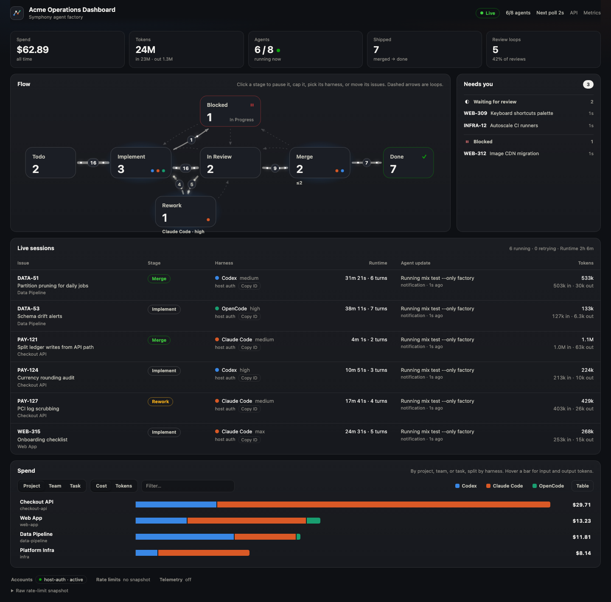
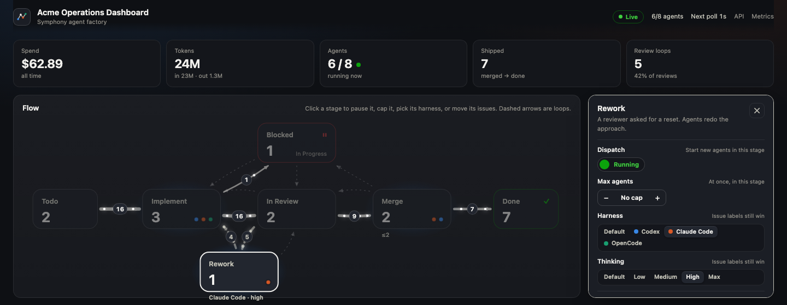
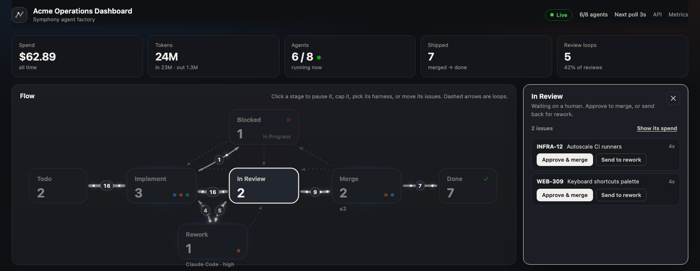
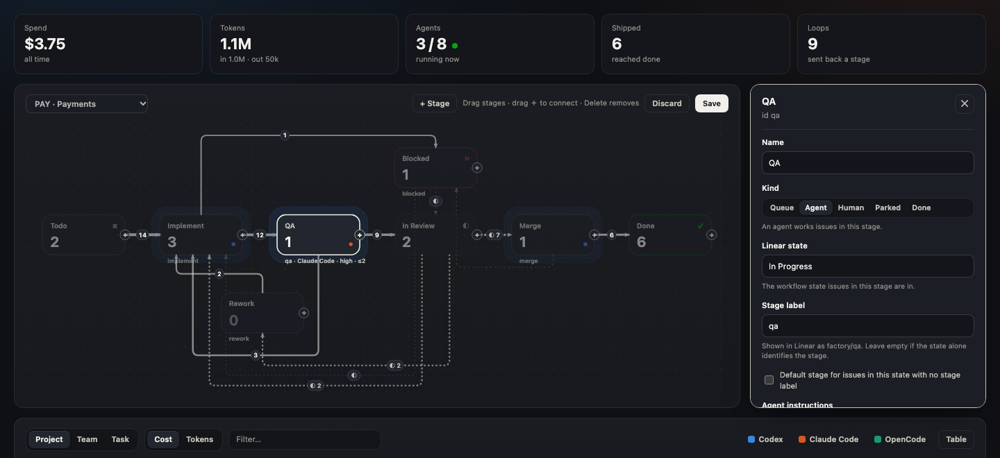
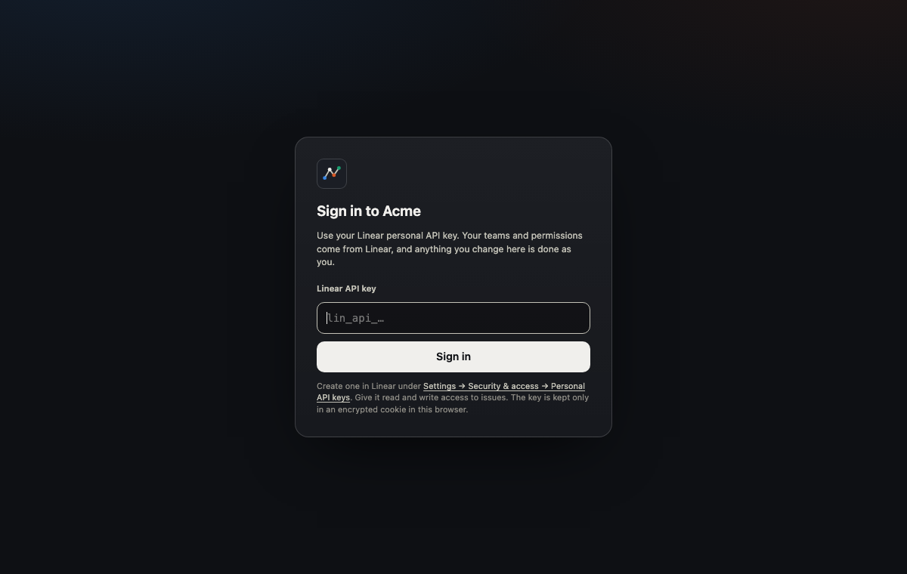
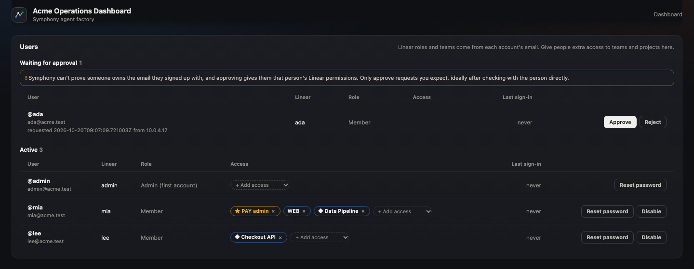

# Symphony Elixir

This directory contains the current Elixir/OTP implementation of Symphony, based on
[`SPEC.md`](../SPEC.md) at the repository root.

> [!WARNING]
> Symphony Elixir is prototype software intended for evaluation only and is presented as-is.
> We recommend implementing your own hardened version based on `SPEC.md`.

## Screenshot


## How it works

1. Polls Linear for candidate work
2. Creates a workspace per issue
3. Launches the configured unattended agent backend inside the workspace
4. Sends a workflow prompt to that backend
5. Keeps the backend working on the issue until the work is done

Supported backends today are Codex, OpenCode, and Claude Code.

During unattended agent sessions, Symphony also bootstraps a workspace-local Linear integration so
that repo skills can make raw Linear GraphQL calls without storing secrets in the repo. OpenCode
gets a generated custom tool, and Claude Code gets a generated workspace-local MCP server.

If a claimed issue moves to a terminal state (`Done`, `Closed`, `Cancelled`, or `Duplicate`),
Symphony stops the active agent for that issue and cleans up matching workspaces.

## Features

- Multi-backend orchestration with Codex, OpenCode, and Claude Code.
- Multi-project routing from one Symphony instance to multiple repos and repo-local `WORKFLOW.md`
  files.
- Per-project backend defaults in `symphony.yml`.
- Per-ticket backend switching through Linear labels like `codex`, `claude`, and `opencode`.
- Per-ticket thinking/effort switching through Linear labels like `thinking/high` and
  `thinking/max`.
- Repo-local workflow prompts and hooks, with global runtime settings kept in `symphony.yml`.
- Workspace-local Linear tooling so agents can comment on issues and run GraphQL operations without
  committing secrets into the repo.

## How to use it

1. Make sure your codebase is set up to work well with agents: see
   [Harness engineering](https://openai.com/index/harness-engineering/).
2. Get a new personal token in Linear via Settings → Security & access → Personal API keys, and
   set it as the `LINEAR_API_KEY` environment variable.
3. Copy this directory's `symphony.yml` somewhere outside your repo or into an ops/config repo.
4. Copy this directory's `WORKFLOW.md` into each repo Symphony should operate on.
4. Optionally copy the `commit`, `push`, `pull`, `land`, and `linear` skills to your repo.
   - The `linear` skill expects Symphony's `linear_graphql` app-server tool for raw Linear GraphQL
     operations such as comment editing or upload flows.
5. Customize `symphony.yml` with your Linear, backend, and project-routing config.
6. Customize each copied repo-local `WORKFLOW.md` with that repo's hooks, prompt, and local agent
   overrides.
   - To get a Linear project's slug, right-click the project and copy its URL. The slug is part of
     the URL.
   - Configure the exact Linear workflow states listed in the `Linear setup` section below.
7. Follow the instructions below to install the required runtime dependencies and start the service.
8. For a concrete two-project walkthrough, see [`SETUP.md`](./SETUP.md).

## Prerequisites

We recommend using [mise](https://mise.jdx.dev/) to manage Elixir/Erlang versions.

```bash
mise install
mise exec -- elixir --version
```

## Run

```bash
git clone https://github.com/openai/symphony
cd symphony/elixir
mise trust
mise install
mise exec -- mix setup
mise exec -- mix build
mise exec -- ./bin/symphony ./symphony.yml
```

## Configuration

Pass a custom config path to `./bin/symphony` when starting the service:

```bash
./bin/symphony /path/to/custom/symphony.yml
```

If no path is passed, Symphony defaults to `./symphony.yml`.

Passing a `WORKFLOW.md` path explicitly still works as a legacy single-project mode.

Optional flags:

- `--logs-root` tells Symphony to write logs under a different directory (default: `./log`)
- `--port` also starts the Phoenix observability service and overrides `server.port`
  (default: disabled)

`symphony.yml` is the global runtime config. Repo-local `WORKFLOW.md` files contain YAML front
matter for project-local workflow settings plus a Markdown body used as the agent session prompt.

Minimal example:

```yaml
tracker:
  kind: linear
  api_key: $LINEAR_API_KEY
providers:
  openrouter_api_key: $OPENROUTER_API_KEY
workspace:
  root: ~/code/workspaces
instance:
  name: staging-west
server:
  port: 4000
agent:
  backend: codex
  default_effort: medium
  max_concurrent_agents: 10
  max_turns: 20
codex:
  command: codex app-server
claude:
  command: claude
  permission_mode: bypassPermissions
opencode:
  command: opencode serve --hostname 127.0.0.1 --port 0
  agent: build
projects:
  - linear_project: "project-a"
    repo: git@github.com:your-org/project-a.git
    workflow: /absolute/path/to/project-a/WORKFLOW.md
```

```md
---
hooks:
  after_create: |
    mise trust
    mise exec -- mix deps.get
agent:
  default_effort: medium
  max_turns: 20
---

You are working on a Linear issue {{ issue.identifier }}.

Title: {{ issue.title }} Body: {{ issue.description }}
```

Multi-project routing example:

```yaml
tracker:
  kind: linear
  api_key: $LINEAR_API_KEY
workspace:
  root: ~/code/workspaces
agent:
  backend: codex
codex:
  command: codex app-server
claude:
  command: claude
  permission_mode: bypassPermissions
opencode:
  command: opencode serve --hostname 127.0.0.1 --port 0
  agent: build
projects:
  - linear_project: "project-a"
    repo: ./dev/project-a
    workflow: ./dev/project-a/WORKFLOW.md
    workspace_root: ./dev/project-a-workspaces
    backend: codex
  - linear_project: "project-b"
    repo: ./dev/project-b
    workflow: ./dev/project-b/WORKFLOW.md
    backend: claude
```

Provider switching example:

```text
Default config:
- agent.backend: codex
- projects["project-b"].backend: claude

Per-ticket behavior:
- no backend label on a project-b issue -> Claude Code
- label the same issue with `codex` -> Codex
- label the same issue with `opencode` -> OpenCode
```

Notes:

- If a value is missing, defaults are used.
- `projects` lets Symphony poll multiple Linear projects and route each issue by its
  `project.slugId`.
- `projects[].repo` is optional. When set, Symphony clones that repo into a brand-new workspace
  before running `hooks.after_create`.
- `projects[].workflow` is required in `symphony.yml` and must point at the repo-local
  `WORKFLOW.md` Symphony should use for that Linear project.
- `projects[].workspace_root` is optional. When omitted, Symphony uses
  `workspace.root/<project-slug>/<issue-identifier>` for multi-project workflows so different
  projects do not collide under the shared root.
- `projects[].backend` is optional. When omitted, Symphony falls back to `agent.backend`.
- In multi-project mode, repo-local `WORKFLOW.md` files may define `hooks.*`,
  `agent.default_effort`, `agent.max_turns`, and the prompt body only.
- `tracker.project_slug` remains the legacy single-project shorthand when you explicitly start
  Symphony with a `WORKFLOW.md` path.
- `agent.backend` accepts `codex`, `opencode`, or `claude`. If omitted, Symphony infers the
  backend from a single configured provider block; ambiguous or empty provider config falls back to
  `codex`.
- `agent.default_effort` accepts `low`, `medium`, `high`, or `max`. If unset, each backend uses its
  own default reasoning level.
- `opencode.command` defaults to `opencode serve --hostname 127.0.0.1 --port 0`.
- `opencode.agent` defaults to `build`.
- `opencode.model` is optional and must use `provider/model` format when set.
- `claude.command` defaults to `claude`.
- `claude.model` is optional.
- `claude.permission_mode` defaults to `bypassPermissions`.
- Claude Code supports both local runs and SSH workers. Each local or remote worker must already
  have working Claude credentials, and the first Claude bootstrap assumes `node` is available so
  Symphony can generate a workspace-local MCP server.
- Codex uses the public `max` effort setting and maps it to Codex's `xhigh` launcher setting.
- `agent.max_turns` caps how many back-to-back unattended turns Symphony will run in a single agent
  invocation when a turn completes normally but the issue is still in an active state. Default: `20`.
- OpenCode v1 is local-only in Symphony. `worker.ssh_hosts` and
  `worker.max_concurrent_agents_per_host` are rejected during config validation.
- OpenCode stays local-only even when other backends use SSH workers. A ticket labeled `opencode`
  runs locally on the orchestrator host.
- OpenCode permissions are handled automatically for a limited unattended allowlist inside the
  issue workspace. Requests outside the workspace, `external_directory`, unknown permissions, and
  interactive questions are rejected.
- If the Markdown body is blank, Symphony uses a default prompt template that includes the issue
  identifier, title, and body.
- Use repo-local `hooks.after_create` to bootstrap a fresh workspace after Symphony clones the
  configured repo. You can also omit `projects[].repo` and do the clone inside `hooks.after_create`
  yourself if that fits your setup better.
- If a hook needs `mise exec` inside a freshly cloned workspace, trust the repo config and fetch
  the project dependencies in `hooks.after_create` before invoking `mise` later from other hooks.
- `tracker.api_key` reads from `LINEAR_API_KEY` when unset or when value is `$LINEAR_API_KEY`.
- `providers.openrouter_api_key` reads from `OPENROUTER_API_KEY` when unset or when value is `$OPENROUTER_API_KEY`.
- `accounts.enabled` turns on managed Codex/Claude account rotation. Managed accounts live under
  `accounts.store_root` (default `~/.symphony/accounts`) and are selected per worker run with
  usage-aware round robin.
- For path values, `~` is expanded to the home directory.
- For env-backed path values, use `$VAR`. `workspace.root` resolves `$VAR` before path handling,
  while `opencode.command` stays a shell command string and any `$VAR` expansion there happens in the
  launched shell.

```yaml
tracker:
  api_key: $LINEAR_API_KEY
providers:
  openrouter_api_key: $OPENROUTER_API_KEY
workspace:
  root: $SYMPHONY_WORKSPACE_ROOT
opencode:
  command: "$OPENCODE_BIN serve --hostname 127.0.0.1 --port 0"
  agent: build
  model: openai/gpt-5.3
projects:
  - linear_project: project-a
    workflow: $PROJECT_A_WORKFLOW
```

- If `symphony.yml` is missing or has invalid YAML at startup, Symphony does not boot.
- In multi-project mode, if a route's `WORKFLOW.md` is missing or invalid, Symphony does not boot.
- If a later reload fails, Symphony keeps running with the last known good config and logs the
  reload error until the file is fixed.
- `server.port` or CLI `--port` enables the optional Phoenix LiveView dashboard, Prometheus
  metrics, and JSON API at `/`, `/metrics`, `/api/v1/state`, `/api/v1/<issue_identifier>`,
  `/api/v1/refresh`, and `/api/v1/issues/<issue_identifier>/messages`.

### Telemetry metrics and traces in the dashboard

When `telemetry` exports agent signals to an OpenTelemetry collector that writes ClickHouse (the
collector's `clickhouse` exporter) and/or Langfuse, Symphony can read them back for the dashboard
through `SymphonyElixir.Observability`: factory and per-issue token, cost, tool-call, turn and
API-latency totals with chart series, top tools and issues, recent traces per issue, a
waterfall-ready span list per trace, and recent tool-result/API-error events. Both sources are
optional; without them these views report "not configured" and nothing else changes.

```yaml
observability:
  timeout_ms: 3000        # per request (default 3000)
  cache_ttl_ms: 30000     # results are cached this long (default 30000)
  clickhouse:
    url: http://127.0.0.1:8123        # ClickHouse HTTP interface
    user: symphony
    password: $SYMPHONY_CLICKHOUSE_PASSWORD
    database: otel                    # default "otel"
  langfuse:
    url: http://127.0.0.1:3000
    public_key: $LANGFUSE_PUBLIC_KEY
    secret_key: $LANGFUSE_SECRET_KEY
    # public_url: https://langfuse.example.com   # optional; only used to build "open in Langfuse" links
```

- Every value may be a `$VAR` reference; a variable that is unset leaves the field unset.
- ClickHouse queries are read-only `SELECT`s with typed query parameters and no per-query
  settings, so a user with the `readonly` profile (`readonly=1`) works. It needs `SELECT` on
  `otel_metrics_sum`, `otel_metrics_histogram`, `otel_logs`, `otel_traces` and
  `otel_traces_trace_id_ts`.
- Langfuse is read through its public REST API (`/api/public/traces`, `/api/public/projects`), not
  its own ClickHouse tables. Trace details prefer Langfuse observations (they carry usage and
  cost) and fall back to ClickHouse spans; traces bigger than 500 spans come from ClickHouse,
  trimmed to the root, errors and longest spans.
- Codex reports no cost, so Codex cost is estimated from `pricing` and also reported as
  `estimated_cost_usd`. Claude cost is what Claude Code reports.
- The return shapes are documented in the `SymphonyElixir.Observability` moduledoc.

## Backend support

### Managed Accounts

When account rotation is enabled, add accounts one at a time from the same shell where the provider
CLI is available:

```bash
./bin/symphony accounts login codex personal --email you@example.com
claude
./bin/symphony accounts import claude work --email you@company.com
./bin/symphony accounts list
```

Codex accounts use an isolated `CODEX_HOME`. For Claude, the most reliable SSH flow is to sign in
or switch accounts with the Claude CLI directly, then import the active Claude auth/config into the
managed account with `accounts import claude <id>`. Repeat the direct Claude login plus import for
each account id. If your direct Claude CLI uses a non-default config directory, pass it explicitly:

```bash
./bin/symphony accounts import claude work --email you@company.com --from "$CLAUDE_CONFIG_DIR"
```

Claude `accounts login` is still available for token-based onboarding: it runs `setup-token` and
stores the emitted OAuth token for later injection via `CLAUDE_CODE_OAUTH_TOKEN`. If you already
have a token, avoid browser login with `--token-stdin`, `--token-file <path>`, or
`--token-env <VAR>`. If an account is already maxed out, pause it before starting Symphony:

```bash
./bin/symphony accounts pause codex personal --reason "daily quota exhausted"
./bin/symphony accounts resume codex personal
```

During dispatch, Symphony skips paused, disabled, cooling-down, rate-limited, over-budget, and
already-in-use accounts before rotating through the rest. If every account for a backend is
unavailable, the issue stays in retry/backoff until an account becomes usable.

Each account directory also gets `usage_periods.csv` when Codex or Claude reports a `session` or
`weekly` rate-limit reset. Rows include the reset transition, usage percentage, weekly percentage
where applicable, and local token totals accumulated during that provider period.

To feed the local Grafana `Account Usage` dashboard, run Symphony with `--port 4000` or
`--port 4001` (or set `server.port` to one of the ports scraped by vmagent). The observability
stack scrapes both ports by default so multiple Symphony instances on the same host can export
metrics side-by-side, each tagged with its own `instance_name` label. When the observability
stack runs in Docker, also set `server.host: 0.0.0.0` so `vmagent` can reach
`host.docker.internal:<port>/metrics`. Otherwise the quota and billing-cycle panels stay empty
even though the endpoint works from your local browser.

### Codex

- Supports unattended work through the Codex app server.
- Uses the public `low`, `medium`, `high`, and `max` effort settings; `max` maps to Codex's
  launcher-specific `xhigh` setting internally.

### Claude Code

- Supports local runs and SSH worker hosts.
- Boots a workspace-local MCP server so repo skills can talk to Linear safely during agent runs.
- Uses `claude.command`, optional `claude.model`, and `claude.permission_mode`.

### OpenCode

- Supports unattended work through `opencode serve`.
- Runs local-only in Symphony today, even if other backends use SSH workers.
- Gets a generated workspace-local Linear tool for issue comments and GraphQL operations.
- Uses `opencode.command`, `opencode.agent`, and optional `opencode.model`.

## Linear setup

Symphony works with Linear's default workflow states; no custom states are
required:

- `Backlog`, `Todo`, `In Progress`, `In Review`, `Done`, `Canceled`, `Duplicate`

Sub-stages within a state are carried by labels. Create a label group named
`factory` (team or workspace level) with these children:

| Label               | Used with     | Meaning                                       | Set by |
| ------------------- | ------------- | --------------------------------------------- | ------ |
| `factory/implement` | `In Progress` | Build, validate, open PR (also the default)   | agent  |
| `factory/rework`    | `In Progress` | Reviewer requested a full reset               | human  |
| `factory/merge`     | `In Progress` | Approved; agent lands the PR then marks Done  | human  |
| `factory/blocked`   | `In Progress` | Parked; Symphony will not dispatch it         | either |

The lifecycle is `Todo` -> `In Progress` (implement) -> `In Review` (human) ->
`In Progress` + `factory/merge` -> `Done`, with `factory/rework` as the loop back.
A Linear label group only allows one child per issue, so an issue is never in two
stages at once. Flat labels named `factory/<stage>` also work.

Relevant `tracker` settings (defaults shown):

```yaml
tracker:
  active_states: [Todo, In Progress]
  stage_label_prefix: factory # label group name
  paused_stages: [blocked, review] # stages that are never dispatched
  require_label: null # e.g. auto-build: only dispatch issues carrying this label
  approval_label: needs-approval # agents add it when a stage needs a person's approval
```

`paused_stages` matches stage ids, so if a flow has an agent-run stage called `review`, set it to
`[blocked]`.

**Opting issues in.** With `require_label: auto-build`, moving an issue to Todo isn't enough: someone
also has to add the `auto-build` label before an agent picks it up. Removing the label stops the agent
working on it, like pausing its stage. Labels in a group count by their name (`ai/auto-build`).

When an issue's stage changes between turns (for example `rework` -> `implement`),
the running agent finishes its turn and Symphony re-dispatches it with a fresh
first-turn prompt. Workflow prompts can read `{{ issue.stage }}` and
`{{ factory.label_prefix }}`.

Default terminal states recognized by Symphony are:

- `Backlog`
- `Closed`
- `Cancelled`
- `Canceled`
- `Duplicate`
- `Done`

## Workspace isolation

Each issue gets its own standalone git clone, made from a shared per-repo cache
(objects are hardlinked, so clones are cheap). Clones share no refs, index locks,
or checked-out-branch state, so concurrent agents cannot block each other's
`git fetch`, `git checkout main`, or merges. If an issue's workspace is recreated
and its `symphony/<ISSUE>` branch already exists on the remote, the new clone
resumes that branch instead of resetting it. A workspace whose bootstrap or
`after_create` hook fails is deleted so the next attempt starts clean.

### Scheduling

`agent.max_concurrent_agents` is also the limit on issues in the pipeline:
- **Leaving the queue.** An issue leaves a queue stage (such as Todo) only while fewer issues than that are in agent stages.
- **Freeing a slot.** Moving to done, blocked or another human stage frees a slot. An issue between runs (retrying, waiting on CI) keeps its slot, so work already started is never crowded out by new work.
- **Order.** When issues wait for a free agent, the one furthest along the flow goes first (its distance from the queue in the flow's transitions), then Linear priority, then age.

### Editing flows on disk

Each scope's flow is a file in `~/.symphony/factories` (`<TEAM>.json`, `project--<slug>.json`, `DEFAULT.json`). The dashboard's flow editor is the usual way to change one, but you can also edit the file:
- **Pickup.** Symphony rescans the directory every couple of seconds and loads a changed file once it validates, with no restart.
- **Bad edits.** An invalid edit is logged, and the last good flow stays.
- **Deleting a file** returns that scope to its inherited flow.
- **Version.** Bump `version` when you edit. A dashboard save based on an older version is then refused instead of overwriting yours.

### Session resume

A restart doesn't throw away an agent's work in progress. While a run is going, Symphony records its session in `~/.symphony/sessions.json`: the issue, stage, backend and workspace, plus Codex's thread id or Claude Code's session id.

- **Ending normally.** When the run finishes, by success or by error, the record is removed.
- **Interrupted runs.** A run cut off by a restart keeps its record. The next run for the same issue, stage, backend and workspace resumes the conversation (Codex `thread/resume`, Claude Code `--resume`), with a short "continue" message instead of the stage prompt.
- **Fallback.** If the session can't be resumed (for example, its sandbox was recreated), or the issue has moved on, the run starts fresh as before.
- **OpenCode** sessions always start fresh.

### Retry queue

Issues waiting for a retry or a continuation check are saved in `~/.symphony/retries.json` with their attempt number, backoff due time and run metadata.
- **On restart** each one is claimed again and re-armed for its remaining delay, so the first poll doesn't dispatch it early and its attempt count isn't reset.
- **Overdue retries.** A retry that came due while Symphony was down runs right away.

### State in Postgres

By default Symphony keeps its state in owner-only files under `~/.symphony`: sessions, retries, usage, users, the agent inbox, factory flows and the dashboard session secret. Set `SYMPHONY_DATABASE_URL` (for example `ecto://symphony:secret@db:5432/symphony`) and the same documents are kept in Postgres instead, in a `state_documents` table keyed by their path under `~/.symphony` (`sessions.json`, `factories/PAY.json`).
- **Why.** The controller can be replaced, rescheduled or rebuilt without losing state. This is the first step towards running it on Kubernetes.
- **Schema.** Migrations run at start-up, before any store loads. They are safe when two instances start together.
- **Flows.** Flows are rescanned from the table every couple of seconds, as they are from disk, so a flow saved by another instance is picked up the same way.
- **Pool size** comes from `SYMPHONY_DATABASE_POOL_SIZE` (default 10).
- **Not moved yet.** Managed account credentials (`accounts.store_root`) stay on disk, because the agent CLIs read them from there.
- **Moving existing state.** Nothing is copied automatically. To keep the current files, insert each one as a row: `key` is its path relative to `~/.symphony`, `body` its contents.
- **Tests.** The store's tests are tagged `:postgres` and run when `SYMPHONY_TEST_DATABASE_URL` points at a database (`ecto://postgres@localhost/symphony_test`). Coverage only reaches its threshold with them, so CI starts a Postgres service.

### Delayed restart

A delayed restart lets you deploy without cutting off running agents.
- **What it does.** Symphony starts no new agent runs: no issue leaves the queue, no next stage starts after a transition, and no retry runs. Once the last running agent finishes, Symphony stops cleanly, and a supervisor such as systemd with `Restart=always` starts it again with the new binary or config.
- **Triggers.** Send `SIGHUP` (`systemctl reload symphony` with `ExecReload=/bin/kill -HUP $MAINPID`), or `POST /api/v1/restart` as an admin or with `server.api_token`.
- **Cancel** with `DELETE /api/v1/restart`.
- **While pending,** the dashboard shows "Restart pending", and `/api/v1/state` carries `delayed_restart`.

### Docker sandbox

Set `sandbox.kind: docker` to run each issue's hooks and agent process inside its
own container:

```yaml
sandbox:
  kind: docker
  image: symphony-agent:latest # must provide bash, git, gh, and codex/claude (+ node for Claude)
  env: [GH_TOKEN, ANTHROPIC_API_KEY, OPENAI_API_KEY] # passed through by name
  mounts: ["~/.gitconfig:/root/.gitconfig:ro"]
  # network: bridge
  # run_args: ["--cpus", "4", "--memory", "8g"]
```

The container is created on first use, bind-mounts the workspace and the managed
accounts store at their host paths, persists across runs for the same issue (so
installed dependencies and services survive), and is removed with the workspace.
Git bootstrap still runs on the host. OpenCode and SSH worker hosts are not yet
supported with the sandbox; Symphony refuses those runs with an explicit error.

## Label routing

Symphony lowercases Linear label names before matching, so label routing is case-insensitive even
though the documented labels below are shown in their exact lowercase form.

Built-in backend routing labels:

- `codex`
- `claude`
- `opencode`

Built-in thinking routing labels:

- `thinking/low`
- `thinking/medium`
- `thinking/high`
- `thinking/max`

Routing behavior:

- If exactly one backend label is present, Symphony uses that backend for the ticket.
- If no backend label is present, Symphony falls back to `agent.backend`.
- If multiple backend labels are present, Symphony logs a warning and falls back to `agent.backend`.
- If exactly one thinking label is present, Symphony uses that effort for the ticket.
- If no thinking label is present, Symphony falls back to `agent.default_effort`.
- If multiple thinking labels are present, Symphony logs a warning and falls back to
  `agent.default_effort` when set.
- Legacy `effort/*` labels are still accepted for compatibility.

Selection precedence:

- Backend precedence is `agent.backend`, then `projects[].backend`, then a backend label on the
  Linear issue.
- Effort precedence is global `agent.default_effort`, then repo-local `WORKFLOW.md`
  `agent.default_effort`, then a Linear thinking label.

Example:

- A `project-b` issue can default to Claude Code because `projects[].backend` is `claude`.
- Adding a `codex` label switches just that one ticket to Codex.
- Adding `thinking/max` keeps the same ticket on its chosen backend but increases reasoning effort.

## Web dashboard

Open `http://127.0.0.1:<server.port>/`. The page is laid out in the order an operator needs it.



The look follows n8n's site: dotted paper, soft grey cards, mono uppercase labels, dot-matrix
headline numbers, black pills for what is selected and pink for the action to take.

- **Top bar**: links to the factory, sessions, spend, and **Traces & metrics** pages, the team
  picker, live or offline, agents in use vs capacity, next poll. Pick a
  team to narrow the whole page (numbers, flow, needs-you, sessions, spend) to that team's work
  and its projects; **All teams** shows everything you can see. The choice is remembered per
  browser and is in the URL (`/?team=PAY`).
- **Headline numbers**: spend, tokens in/out, live agents, shipped issues, and how often
  review sent work back.
- **Flow**: the factory as a live diagram. Each node is a Linear state plus `factory/*`
  stage, edge weights are observed transitions, and dashed edges are loops back for rework.
  Colored dots on a node are the agents running there, by harness.
- **Needs you**: the only things waiting on a human. That means issues in review (oldest first),
  blocked issues, retries with their error, and accounts that are limited or exhausted.
- **Live sessions**: what each agent is doing now, with its stage, harness, thinking level,
  runtime, latest update, and tokens.
- **Spend**: cost or tokens grouped by project, team (the Linear key, for example `PAY`), or
  task, split by harness. Hover a bar for input and output tokens, or switch to the table view.

### Traces and metrics

`/insights` reads the factory's own telemetry back (needs the `observability` section; see
"Telemetry metrics and traces in the dashboard"): tokens, cost, turns, tool calls and API
latency for the last hour, day or week, charts of tokens, cost and tool calls by harness, the
issues and tools that used the most, and for a picked issue its metrics by model, its recent
traces, and a waterfall of the trace you open. Issues you can't see are left out. The chat's
≋ button opens the issue here.

### Transcripts and messaging an agent

Each issue has a chat-style transcript of what its agents did: their messages and thinking,
the commands they ran (with output, exit code, and duration), the files they edited (with
added and removed line counts), other tool calls, a marker at the start of each turn, and
Symphony's own stage moves. It's kept in memory (the newest 400 entries per issue) and built
the same way for Codex, Claude Code, and OpenCode.

You can also send a message to the agent working on an issue. Anyone who may move the issue
can send one (admins, the local operator, and members of the issue's team); guests can read
them but not send. How a message reaches the agent:

- **Codex, during a turn**: it's sent into the running turn right away (app-server
  `turn/steer`), and shows as "steered".
- **Otherwise** (Claude Code, OpenCode, Codex between turns, or no agent running): it waits
  and is put at the top of the next turn prompt any agent runs for that issue, and shows as
  "next turn". If a run is about to stop at `agent.max_turns` with messages waiting, it runs
  one more turn so the agent can answer. Claude Code is never interrupted mid-turn: in
  `stream-json` mode every user message starts a new turn.

Messages that haven't reached an agent yet are saved to `~/.symphony/inbox.json`, so a restart
doesn't lose them. The API: `GET /api/v1/issues/<identifier>/messages` lists an issue's
messages, and `POST` to the same path with a JSON body `{"text": "..."}` sends one (`404` if
you can't see the issue, `403` if you can't move it, `422` for an empty or over-8,000-character
message). In Elixir, `SymphonyElixir.AgentInbox.send_message/3` and `messages/1` do the same,
and `SymphonyElixir.Transcript.entries/1` returns the transcript.

### Flows per team and project, and steering them

Each team, and each Linear project, can have its own factory flow: the stages work moves
through and how they connect. An issue follows the most specific flow that exists:

1. its **project's** flow, if the project has one
2. otherwise its **team's** flow
3. otherwise the organisation's **default** flow, which starts as Symphony's built-in flow

Pick the flow at the top of the diagram. The list shows the default flow, teams, and projects,
and says which flow each one uses until it has its own (for example "Checkout API, uses PAY
flow"). A team's diagram leaves out issues in projects that have their own flow; those show on
the project's diagram. `#team=PAY&stage=qa` or `#team=project%3Acheckout-api` deep-links to a
flow and stage.

Click a stage to manage it. Its panel replaces the Needs-you column so the whole diagram stays
visible.



For stages agents work in, you can:

- **Pause dispatch.** No new agents start in that stage; running ones finish their turn.
- **Cap concurrency.** Set the most agents allowed in that stage at once.
- **Pick the harness and thinking level** used by default in that stage. An issue's own `codex`,
  `claude`, or `thinking/*` labels still win.

Each stage lists its issues, with a button for every connection a person can move them along.
For example, In Review offers Merge, Rework, and Implement. Moves write the state and stage
label back to Linear.



#### Editing a flow

**Edit flow** (or **Customize for this project/team** when it still uses an inherited flow)
turns the diagram into an editor. Saving a project or team that inherited creates its own
flow; **Use team flow** / **Use default flow** in the editor removes it again.



- **Stages.** Use **+ Stage** to add one, drag stages to place them, and click one to set its:
  - name
  - **kind**: *queue* (waiting for an agent), *agent*, *human*, *parked* (never dispatched), or
    *done*
  - **Linear state**, plus an optional **stage label**. Many stages can share a state; for
    example, Implement, QA, and Merge all live in In Progress, told apart by label.
  - agent instructions
  - default harness, thinking level, and agent cap
- **Connections.** Drag from a stage's ＋ handle to another stage. Each connection says whether
  an **agent** or a **person** moves issues along it, and when (its exit criteria). Agents are told
  their allowed moves; people get buttons for theirs.
- **Routing.** Lines are drawn at right angles with rounded corners, spaced apart where they
  share a side, with loops kept in their own lanes.
- **Saving.**
  - Saving checks the flow (for example: every stage needs a Linear state, and there's a done
    stage) and lists any problems.
  - If someone else saved first, you're told rather than overwriting their change.
  - On save, Symphony creates the `factory` label group and any missing stage labels in
    Linear: in the team, or for a project, in every team with issues in it.
- **Who can edit.** Team members edit their own team's flow and the flows of projects their team
  works in; people given a project edit its flow; admins edit any flow, including the
  organisation default.

#### How stages hand off

Each stage is a fresh agent, possibly on a different harness, so stages pass work through two
channels that every agent is told about:

- **The Linear issue.** A stage reads the comments earlier stages posted, then posts its own output
  as one comment headed with its name (`## Research APIs`, `## Plan service`, …): what it did, what it
  found or decided, and what the next stage needs. The ticket becomes the full record of the work.
- **The issue's branch, `symphony/<ID>`.** Code travels here. A stage starts from the branch if it
  exists, and commits and pushes before it moves the issue.

#### Approval gates and earned autonomy

A stage can make a person approve the moves an agent makes out of it. The agent makes its move as
usual, says why in its stage comment, and adds the `needs-approval` label (`tracker.approval_label`).
Symphony holds the issue where the agent moved it, and **Needs you** lists it under **Waiting for
your approval** ("In Review → Merge") with a link to the Linear ticket, where the stage comments show
everything that happened. **✓ Approve** keeps the move and removes the label; **↩ Send back**
returns the issue to the stage it came from. Team members can approve their team's issues (and
anyone given the issue's project); the stage panel has the same buttons.

- **Always:** tick ✋ on a stage (in the editor, or right-click it on the diagram) and every move out
  of it needs approval.
- **Earned autonomy:** the **✋ Earned autonomy** setting above a flow makes every agent stage need
  approval until it gets N approvals in a row (10 by default, 1 to 100). Each stage shows its
  progress (`✋ 3/10`), and once it has earned it, `✓ trusted`. A send-back starts that stage's count
  again. Changing the setting restarts every count.

Right-click any stage for quick controls: approval, pause, harness (each shows the model it runs),
and thinking level. Zoom with ⌘/Ctrl + scroll or a pinch, pan by dragging the background, and use
the − / + / Fit buttons in the corner.

Agents get a **"Your current stage"** section in their prompt. It has the stage's instructions,
the stage's skill if it has one, and each allowed move with the exact Linear state and label to
set. Workflow templates can place it themselves with `{{ stage.prompt }}`.

#### Designing a flow with AI

**✦ Design with AI** (above the diagram, or **✦ Draft flow with AI** while editing) designs a
whole flow from a description of your process, for example: "Agents implement and open a PR.
A second agent reviews the diff for security issues and sends it back if it finds any. Then QA
runs Playwright against the preview deploy. A person approves, an agent merges."

- It starts from the flow the team or project uses now, keeps stage ids where a stage keeps its
  purpose, and writes every stage's instructions and, optionally, skill files for agent stages.
- The draft is checked like a save. If it isn't a valid flow, the harness is shown the problems
  and gets one chance to fix them.
- Runtime controls (harness, thinking level, agent cap, pause) carry over for stages that keep
  their id, and new layouts are placed on the grid automatically.
- The preview lists the summary, the stages added, changed, and removed, each stage's
  instructions and skill, and the connections. **Apply to editor** puts it in the editor; nothing
  changes until you **Save**. A whole flow usually takes one to three minutes.

#### Drafting a stage with AI

In a stage's form, **✦ Draft with AI** takes a plain description ("before review, run the
Playwright suite against the preview deploy; send it back if anything fails") and drafts:

- the stage's agent instructions
- its connections, with who moves each one and when
- an optional skill file, which is stored with the stage and added to its prompt

It runs your configured harness (`claude -p`, `codex exec`, or `opencode run`) one-shot in an
empty scratch directory with file, shell, and web tools disallowed. A draft takes 20 to 40
seconds. Nothing changes until you review the preview and click **Apply**, then **Save**.

### Sign-in and permissions

People sign in with a **username and password**. Each account is tied to the Linear user with
the same email, and that user's teams and admin flag set the permissions. On top of Linear,
admins can make people **team admins**, and team admins can give people access to their team or
to a project, without changing anything in Linear.



- **First run**: the first account created becomes the Symphony admin. Creating it needs a
  one-time **setup code** that Symphony prints to its server log at startup (and again when
  someone opens `/signup`), so reaching the page alone isn't enough to claim admin.
- **Everyone else** signs up with the email they use for Linear. Sign-up only works for
  active members of your Linear workspace, checked with Symphony's `tracker.api_key`. New
  accounts wait in **Pending accounts** in the Needs-you rail until an admin approves them.
  Approval is what proves the person really owns that email. Symphony can't verify email
  ownership itself, so the approval screen shows when and from which address each request
  came. Only approve people you expect.

| Who                                         | Can                                                                     |
| ------------------------------------------- | ----------------------------------------------------------------------- |
| Linear workspace admin, or the first account | Everything: any flow, stage controls, accounts, choosing team admins   |
| Team admin (set in Symphony)                | What a team member can, plus give people access to the team and to projects the team works in |
| Team member (in Linear, or given the team)  | See and move the team's issues, edit its flow and its projects' flows   |
| Given a project                             | See and move that project's issues and edit its flow                    |
| Linear guest                                | View only, unless given a team or project                               |
| Not in the workspace                        | Can't sign up                                                           |



- **Users** shows each person's access as chips: their Linear teams, ★ team-admin roles, and teams
  and projects given in Symphony (◆ marks a project). Use **+ Add access** to give more, and ×
  to take it away. Admins see every option; team admins see only their teams and those teams'
  projects, and don't see account actions (approve, reset, disable).
- Changing someone's access refreshes their open dashboards. Grants are stored with the account in
  `~/.symphony/users.json` and logged with who made them.
- People only see issues, sessions, and spend from their teams and the projects they were given
  (admins see everything). Host details such as workspace paths and worker hosts are hidden from
  non-admins.
- Disabling an account, or changing or resetting its password, signs it out everywhere,
  including dashboard tabs that are already open.
- Admins can reset passwords from **Users**. That gives a one-time link (valid 24 hours) to
  send to the person, with no email setup needed.
- Moves are made with Symphony's Linear key, and a comment on the issue records who made
  them (for example "Mia Member (@mia) moved this to In Progress · factory/merge").
- Teams and admin rights are re-read from Linear every 10 minutes. Deactivating someone in
  Linear blocks their sign-in.
- Passwords are hashed with PBKDF2-SHA256 and a per-user salt. After 5 failed attempts the
  account is locked for 15 minutes. Accounts are stored in `~/.symphony/users.json` (mode 0600).
- The session cookie is encrypted and holds only the account id. It's signed with
  `server.secret_key_base` (or `SYMPHONY_SECRET_KEY_BASE`). If neither is set, Symphony
  generates one at `~/.symphony/secret_key_base`, so sessions survive restarts.
- The JSON API and `/metrics` accept a session or `Authorization: Bearer <server.api_token>`
  (for Prometheus and other scrapers).

#### Running in production

- **Use TLS.** Symphony serves plain HTTP, so put it behind a TLS-terminating reverse proxy
  (Caddy, nginx, a load balancer) and set `server.trust_proxy: true`. Symphony then takes the
  client address and `https` from `X-Forwarded-For` / `X-Forwarded-Proto`, which makes the
  session cookie `Secure` and gives each client its own rate-limit bucket. Without
  `trust_proxy`, everyone behind the proxy shares one sign-in limit (20 attempts per 15
  minutes), so set it.
- Only enable `trust_proxy` when the proxy is the sole way to reach Symphony. Otherwise
  clients could spoof those headers.
- Set `server.public_url` to the address people open (e.g. `https://symphony.example.com`).
  LiveView only accepts sockets from that origin. Phoenix checks the origin before any
  proxy header is read, so behind TLS termination the dashboard can't connect without it:
  pages load but never update, and buttons do nothing.
- Set `server.secret_key_base` (or `SYMPHONY_SECRET_KEY_BASE`) when running more than one
  instance, or when `~/.symphony` isn't persistent.
- State lives in `~/.symphony` (accounts, session secret, `factories/<TEAM>.json`, usage), which Symphony
  creates as owner-only (0700, files 0600). Back it up.
- Without sign-in (`local` mode) Symphony only answers requests addressed to `localhost`,
  `127.0.0.1`, or `[::1]`, which blocks DNS-rebinding attacks from web pages.

Sign-in follows where the server listens. On a loopback address (the default `127.0.0.1`)
there is no sign-in and you are the local operator. On any other address, accounts are
required. Override this with `server.auth: local | accounts`.

### Cost

Token usage is recorded per project, team, task, harness, and model in
`~/.symphony/usage.json`, so totals survive restarts. Add rates (USD per million tokens) to
price it, keyed by harness or `harness/model`:

```yaml
pricing:
  claude:
    input_per_mtok: 3
    output_per_mtok: 15
  codex/gpt-5.4:
    input_per_mtok: 1.25
    output_per_mtok: 10
```

Without `pricing`, the dashboard still shows tokens and marks cost as unpriced.

### Under the hood

- LiveView at `/`; the JSON API under `/api/v1/*` (its state payload includes a `factory`
  section with flow, usage, and controls).
- The diagram and spend explorer render client-side from a single payload, so grouping,
  filtering, hover, and opening stages run in the browser. With a 2,000-row usage history,
  these take 0.5 to 0.9 ms (median).
- Bandit HTTP server; dependency-free embedded JS and CSS.

## Project Layout

- `lib/`: application code and Mix tasks
- `test/`: ExUnit coverage for runtime behavior
- `symphony.yml`: global runtime config and Linear project routing
- `WORKFLOW.md`: repo-local workflow contract for a single routed project
- `../.codex/`: repository-local skills and setup helpers used by the workflow

## Testing

```bash
make all
```

Run the real external end-to-end test only when you want Symphony to create disposable Linear
resources and launch a real `opencode serve --hostname 127.0.0.1 --port 0` session:

```bash
cd elixir
export LINEAR_API_KEY=...
make e2e
```

Optional environment variables:

- `SYMPHONY_LIVE_LINEAR_TEAM_KEY` defaults to `SYME2E`

`make e2e` currently targets the local-only OpenCode flow.

The live test creates a temporary Linear project and issue, writes a temporary `symphony.yml` plus
repo-local `WORKFLOW.md`, runs a real agent turn, verifies the workspace side effect, requires
OpenCode to comment on and close the Linear issue, then marks the project completed so the run
remains visible in Linear.

## FAQ

### Why Elixir?

Elixir is built on Erlang/BEAM/OTP, which is great for supervising long-running processes. It has an
active ecosystem of tools and libraries. It also supports hot code reloading without stopping
actively running subagents, which is very useful during development.

### What's the easiest way to set this up for my own codebase?

Launch Codex, Claude Code, or OpenCode in your repo, give it the URL to the Symphony repo, and ask
it to set things up for you.

## License

This project is licensed under the [Apache License 2.0](../LICENSE).
